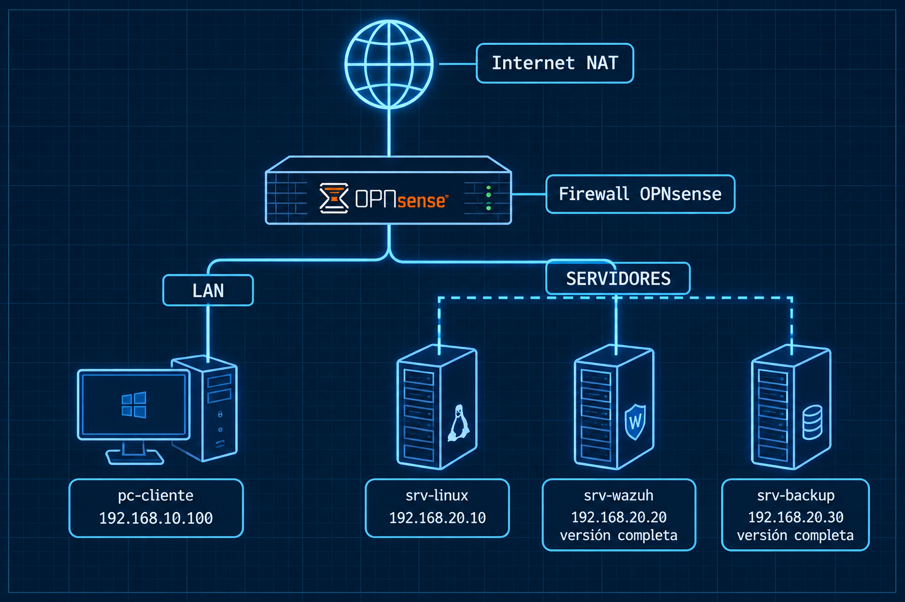

# Ciberseguridad defensiva para una PYME

Diseño e implantación de un entorno de seguridad defensiva sobre un laboratorio virtual: firewall con segmentación de red, acceso SSH seguro, copias de seguridad y monitorización.

| | |
|---|---|
| **Autores** | Isacc Danger Hernandez Consuegra & Ventura Aponte | 
| **Ciclo** | Técnico Superior en Administración de Sistemas Informáticos en Red (ASIR), modalidad virtual |
| **Proyecto** | Proyecto intermodular, curso 2026-2027 |
| **Tutor/a** | Simone Lonescu|
| **Estado** | [ En desarrollo ] |

## El problema

Muchas PYMEs tienen una red plana, acceso SSH con contraseña, copias de seguridad manuales que nunca se han probado y nadie que revise los registros. Un solo equipo infectado puede llegar a los servidores, y un ransomware puede dejar a la empresa sin datos.

## La solución

Un laboratorio que simula una oficina pequeña y la protege con herramientas 100 % de código abierto, comprobando cada medida con una prueba.

### Qué incluye


- Firewall OPNsense con dos zonas (usuarios y servidores) y denegación por defecto
- SSH con claves, root deshabilitado y bloqueo de fuerza bruta (fail2ban)
- Copias de seguridad cifradas con restic y restauración probada
- Política de contraseñas y actualizaciones automáticas
- Monitorización con Wazuh (agentes y alertas)
- Auditoría con Lynis antes y después
- Extras: VPN WireGuard, IDS Suricata, doble factor en SSH

## Arquitectura



| Zona | Red | Equipos |
|---|---|---|
| Usuarios | 192.168.10.0/24 | Firewall .1, equipo de gestión (Windows) .2, pc-cliente .100 |
| Servidores | 192.168.20.0/24 | Firewall .1, srv-linux .10, srv-wazuh .20, srv-backup .30 |

## Reglas del firewall

| Interfaz | N.º | Acción | Origen | Destino | Puerto |
|---|---|---|---|---|---|
| LAN | L1 | Permitir | 192.168.10.100 | 192.168.20.10 | TCP 22 |
| LAN | L2 | Permitir | red LAN | 192.168.20.10 | TCP 80 |
| LAN | L3 | Bloquear (log) | red LAN | red SERVIDORES | cualquiera |
| LAN | L4 | Permitir | red LAN | cualquiera | cualquiera |
| SERVIDORES | S1 | Bloquear (log) | red SERVIDORES | red LAN | cualquiera |
| SERVIDORES | S2 | Permitir | red SERVIDORES | cualquiera | cualquiera |

El orden importa: OPNsense aplica la primera regla que coincide, de arriba abajo.


## Estructura del repositorio

```
.
├── README.md
├── docs/            # memoria, anteproyecto y diagramas (docs/img)
├── configs/         # configuraciones: sshd, fail2ban, netplan, reglas exportadas
├── scripts/         # scripts de copias de seguridad y utilidades
└── evidencias/      # capturas de las pruebas (C1, C2, ...)
```

## Requisitos

- PC con Windows 11 y **16 GB de RAM** si se usa Wazuh. Para el prototipo bastan 8 GB.
- VirtualBox 
- ISO de OPNsense y de Ubuntu Server 26.10 LTS.

## Cómo reproducirlo

1. Crear el repositorio, el tablero Kanban y las máquinas virtuales con las redes de la tabla de arquitectura.
2. Instalar OPNsense y asignar las interfaces: WAN (NAT), LAN (solo anfitrión) y SERVIDORES (red interna).
3. Configurar las IPs fijas de los equipos y las reglas del firewall.
4. Endurecer srv-linux: SSH con claves, fail2ban, contraseñas y actualizaciones.
5. Configurar las copias con restic y probar una restauración.
6. Instalar Wazuh y desplegar el agente.
7. Ejecutar las pruebas de la tabla y guardar las capturas en `evidencias/`.

Los pasos detallados están en [`docs/`](docs/).


## Licencia

GNU General Public License v3.0